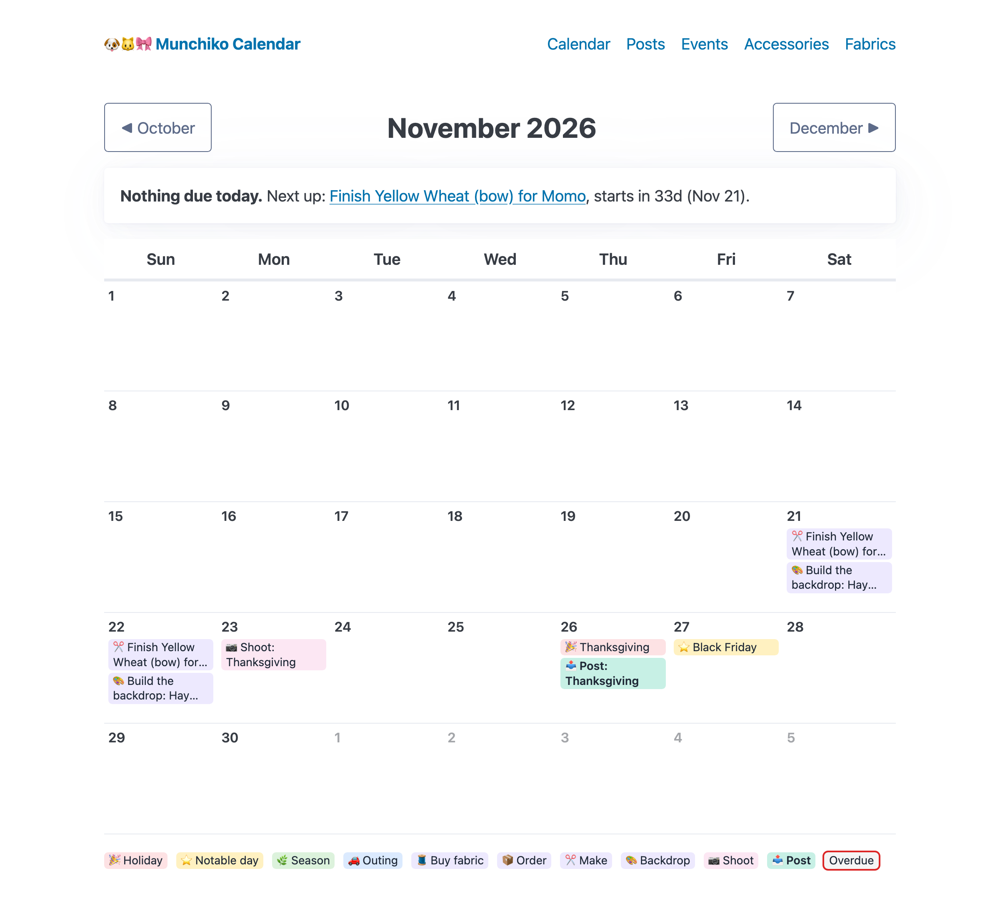
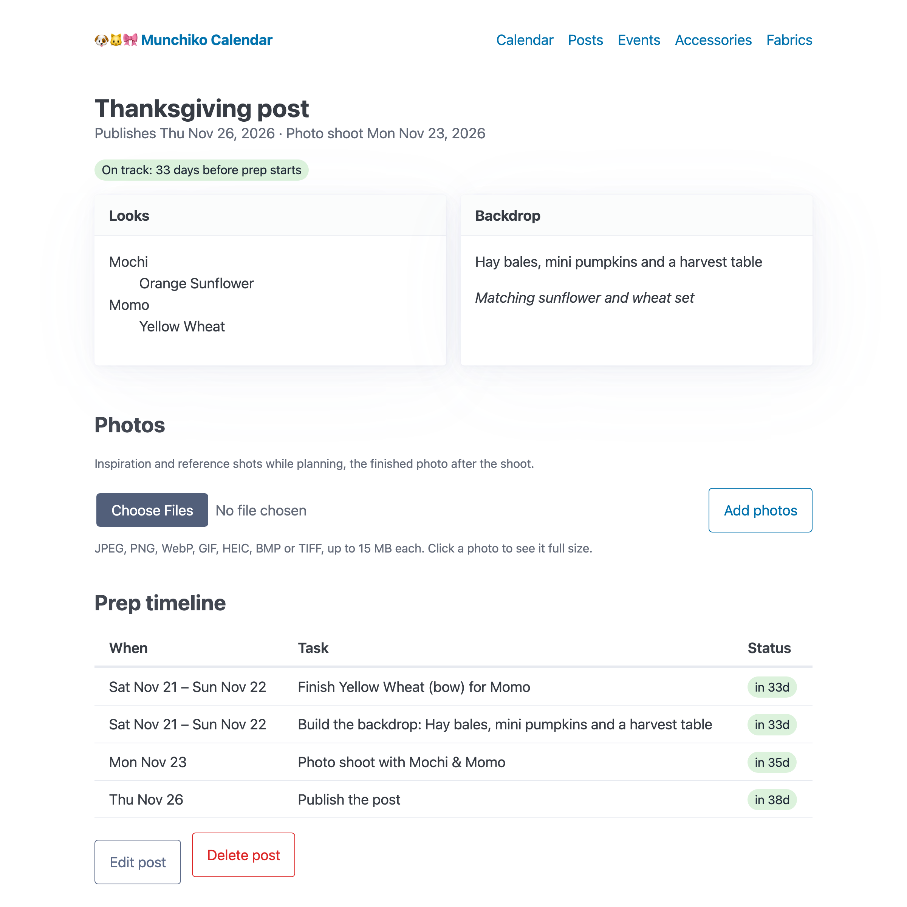
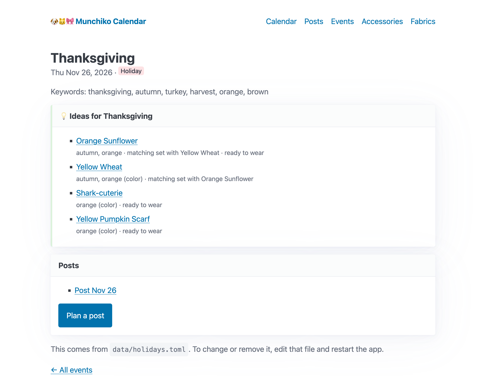
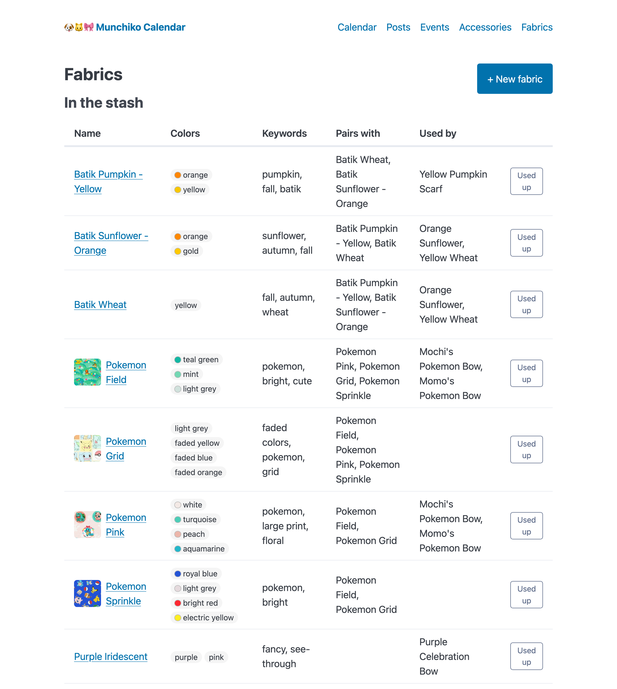
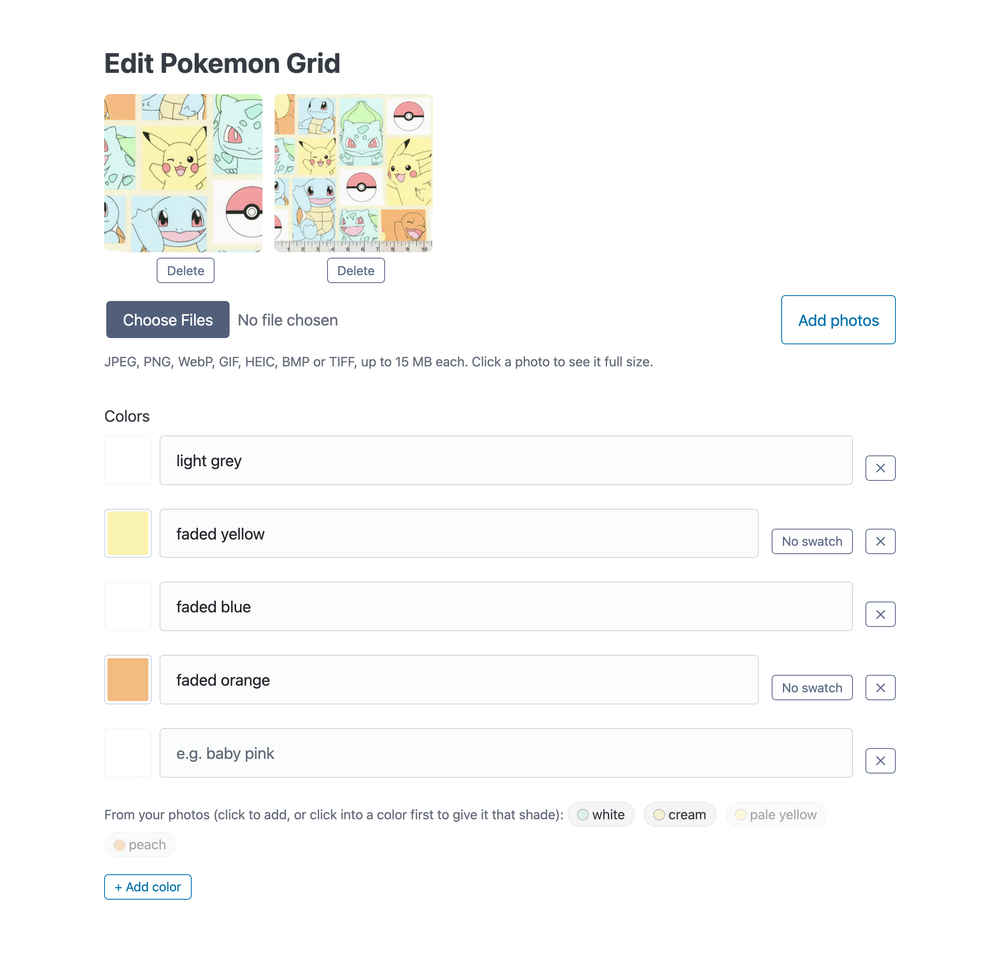
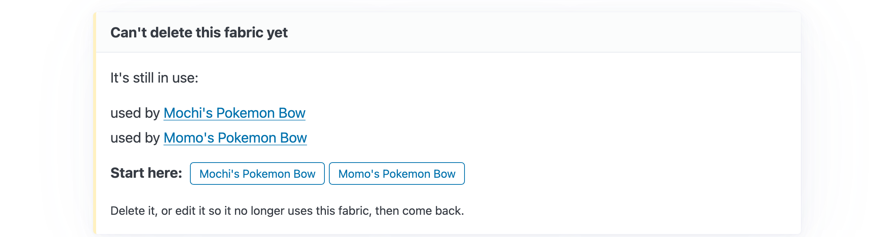

# Munchiko Calendar 🐶🐱🎀

A content planner for **Mochi & Momo's** social media account, written in Rust.

The account posts photos of a dog and a cat in (mostly handmade) bows and
costumes, set against a backdrop for a holiday or notable day: Christmas,
Earth Day, the Ides of March, Shark Week. This tool doesn't make content; it
makes sure the content is *ready on time*. Given a target post date, it works
backward to tell you when to buy fabric, make each bow, build the backdrop and
take the photos, and it suggests what to wear from what's already in the stash.

**Highlights**

- **Backward planning:** each post becomes a dated prep timeline (buy fabric →
  make bow → build backdrop → photo shoot → publish), with the critical path
  and slack worked out, shown on a month calendar.
- **Suggestions with reasons:** "for Thanksgiving, consider the Orange
  Sunflower bow: autumn, orange · matching set · ready to wear".
- **~45 holidays from an editable file**, with date rules for "4th Thursday of
  November", Easter-relative days and multi-day events.
- **Photos and real colors:** upload photos (HEIC converted on a Mac), give
  each color an exact swatch with the picker's eyedropper, or take the main
  colors straight from a photo.
- **Guided errors:** instead of "can't delete", the chain of what's in the way
  and where to start.

**Built with** Rust · Axum · SQLite (sqlx, migrations) · Askama server-rendered
templates · Pico CSS · one small optional script · the `image` crate.
146 tests. Design decisions and trade-offs: **[docs/DESIGN.md](docs/DESIGN.md)**.

## Quick start

Needs Rust 1.85 or newer.

```bash
cargo run    # http://127.0.0.1:3000 (the first build takes a few minutes)
cargo test   # all tests run on in-memory SQLite and temporary folders
```

A brand-new database starts with an example Halloween post, so there's
something to look at.

## Screenshots

The screenshots show real data from the account's stash (its fabrics, bows
and photos), plus two posts planned for the screenshots.

**Calendar:** holidays and every prep task for the Thanksgiving post, worked
backward from Nov 26. The box at the top says what's due today, or what's next.



**A post's prep timeline:** who wears what, the backdrop, and when each task
has to happen.



**Suggestions:** accessories that fit the event, best first, with the reasons
why. The top two are a matching Mochi & Momo set.



**Fabrics:** photo thumbnails, colors with their exact shades, pairings, and
which bows use each fabric.



**Colors from photos:** the main colors of the fabric's photos are offered as
chips. Here "faded yellow" and "faded orange" have just been given the shades
of the "pale yellow" and "peach" chips. (Trimmed view: the name, description
and keyword fields are hidden.)



**Guided deletes:** what's in the way, and where to start.



## How the planning works

```
 buy fabric ──► make bow ──┐
                           ├──► ready day ──► photo shoot ──(editing buffer)──► publish
 order bought item ────────┤
 build backdrop ───────────┘
```

- Everything must be finished the day **before** the shoot.
- Bows, bought items and the backdrop happen **in parallel**; whichever must
  start earliest is the **critical path**.
- **Slack** = days between today and that earliest start. Negative slack means
  the post is already behind schedule.
- Lead times (editing buffer, backdrop build, shipping, fabric shopping) are
  configurable, and each bow can override how long it takes to make.

Example: Halloween (post Oct 31, default lead times):

| When | Task |
|---|---|
| Oct 20 | Order Ghost scarf (bought) |
| Oct 21 – 23 | Buy fabric: Orange velvet (out of stock) |
| Oct 24 – 27 | Make Pumpkin bow for Mochi |
| Oct 26 – 27 | Make Bat bow for Momo · Build the backdrop |
| Oct 28 | Photo shoot |
| Oct 31 | Publish |

## Using the app

| Page | What you can do |
|---|---|
| **Calendar** | Month view of holidays, outings and every post's prep tasks; "to do today" box; overdue work outlined in red |
| **Posts** | Plan a post for an event (with the same ideas shown above the choices), choose who wears what, see its prep timeline and slack, add reference photos |
| **Events** | Upcoming / past holidays and outings; "Plan a post" from any event; **ideas** for what to wear (or which fabric to make something from, and the date to start by); add and edit your own outings (holidays are edited in `data/holidays.toml`) |
| **Accessories** | Bows, scarves, costumes: filter, one-click status, fabrics by role, matching sets, photos |
| **Fabrics** | Stash and shopping list, pairings, what each fabric is used by, photos |

**Colors** have a name ("baby pink") and, optionally, the exact shade from a
color picker, shown as a dot next to the name. Suggestions only look at the
names; the shade is for people. The browser's picker has an eyedropper, and
the photos sit right above the color rows, so a shade can be sampled from them.

**Photos** (up to 15 MB each) can be added to fabrics, accessories and post
plans. JPEG, PNG, WebP and GIF are stored as they are; BMP and TIFF are
converted to PNG, and iPhone HEIC photos to JPEG (on a Mac, using the built-in
`sips` tool; elsewhere the page explains how to export a JPEG). Every photo
gets a small JPEG thumbnail, turned the right way up; the first one is the
thumbnail in the lists.

**"From your photos"** offers the main colors of an item's photos, each with
its exact shade and the nearest name from a built-in list ("teal", "baby
pink"). One click adds it; click into one of your own colors first and the
chip gives that color its shade instead, keeping your name.

## How suggestions work

For an event, every accessory is scored against the event's name and
keywords (filler like "day" or "national" ignored). Plurals match their
singular, so "Fall Leaves" finds a leaf-print bow and a "reds" color matches
"red":

| Match | Points |
|---|---|
| A word in the accessory's name or its fabrics' keywords | 3 |
| One of its colors (or its fabrics' colors, if it uses them) | 2 |
| Bonus, once something matched: half of a Mochi & Momo set | +1 |
| Bonus, once something matched: ready to wear | +1 |

The top five are shown with their reasons ("pumpkin, orange (color) ·
matching set with Bat bow"). If nothing you own fits, fabrics are scored
the same way and shown with the last day to start making a new bow, worked
out by the planner itself.

## Data model

| Model | Key fields |
|---|---|
| **Fabric** | name, description, colors (name + optional `#rrggbb` swatch), keywords, pairings, in stock |
| **Accessory** (bow / scarf / costume) | name, description, colors, fabrics (main/middle/accent), handmade or bought (brand), status (idea → in progress → ready), matching pair |
| **Event** | name, description, type, start/end date, keywords |
| **Post plan** | event, post date, who wears what, backdrop idea |
| **Photo** | belongs to one fabric, accessory or post plan; image type |

Bows are separate items that can be linked as a matching Mochi & Momo set.

## Holidays and notable days

`data/holidays.toml` lists about 45 holidays, fun days, seasons and Mochi &
Momo's birthdays and adoption days. Each entry has one date rule:

| Rule | Example |
|---|---|
| `date = "10-31"` | Halloween |
| `nth_weekday = { n = 4, weekday = "thu", month = 11 }` | Thanksgiving (`n = -1` = last) |
| `easter_offset = -47` | Mardi Gras (Easter is calculated) |
| `by_year = { 2027 = "02-06" }` | Lunar New Year, Shark Week: looked up each year |

Optional `days = 7` makes it multi-day, and `offset_days = 1` shifts it
(Black Friday = Thanksgiving + 1). The app re-reads the file on every start
and syncs this year's and next year's dates into the calendar: new holidays
are added, changed ones updated in place, removed ones deleted (unless a post
is already planned for them). Outings you enter yourself are never touched.

## Storage

Data lives in SQLite (`munchiko.db` by default). The schema is created and
upgraded by numbered migrations in `migrations/`, which run automatically
when the app starts.

| Table | Holds |
|---|---|
| `fabrics` | fabric stash and shopping list |
| `fabric_pairings` | "goes well with" links, stored in both directions |
| `accessories` | bows, scarves, costumes; `pair_id` links a matching set (both ways) |
| `accessory_fabrics` | which fabrics each accessory uses, as main / middle / accent |
| `events` | holidays, notable days, seasons, outings (optional end date); holiday rows remember which file entry and year they came from |
| `post_plans` | a planned post for an event |
| `looks` | which pet wears which accessory in a post |
| `photos` | which item each photo belongs to (exactly one), and its image type; the image files are in the `photos/` folder, named by id |

The database enforces the rules itself: enum values and dates are checked,
colors and keywords must be JSON arrays (a color is
`{"name": "baby pink", "hex": "#f4c2c2"}`, hex optional), a photo must belong
to exactly one thing, and you can't delete a fabric a bow still uses, or an
event or accessory that a planned post still uses.

## Running it

On startup the app runs any new database migrations, syncs holidays from
`data/holidays.toml`, and if the database is brand new adds the Halloween
example post (once you've entered anything yourself it never comes back).

Settings (all optional environment variables):

| Variable | Default | |
|---|---|---|
| `DATABASE_URL` | `sqlite:munchiko.db` | the database file |
| `PHOTOS_DIR` | `photos` | uploaded photos; back it up together with the database |
| `ADDRESS` | `127.0.0.1:3000` | only this computer can reach it, and there's no login |

## Roadmap

- [x] **M1**: Domain models and the backward-planning engine, with tests
- [x] **M2**: SQLite storage with migrations
- [x] **M3**: Editable list of holidays & notable days (fixed dates, "4th Thursday of November", Easter, multi-day events like Shark Week)
- [x] **M4**: Web app (Axum) with a calendar view and forms for inventory and events
  - [x] **M4a**: server, month calendar, "to do today" box, post list and timeline pages
  - [x] **M4b**: fabric and accessory pages and forms
  - [x] **M4c**: event and post plan forms, edits and deletes
- [x] **M5**: Suggestions: "for Earth Day, consider the leaf-print bow" based on keywords and colors
- [x] **M6**: Visual colors and photos
  - [x] **M6a**: color swatches with a color picker / eyedropper
  - [x] **M6b**: photo uploads for fabrics, accessories and post plans
  - [x] **M6c**: thumbnails, and more formats (HEIC, BMP, TIFF) converted on upload
  - [x] **M6d**: suggest a fabric's colors from its photo
- [x] **M7**: Polish
  - [x] **M7a**: plural and singular words match in suggestions
  - [x] **M7b**: portfolio screenshots, design notes, v1.0

Ideas for later: photos in the suggestion box; a calendar nudge for upcoming
events with no post planned yet.

## Project layout

```
data/
  holidays.toml  the editable holidays list
docs/
  DESIGN.md      design decisions and trade-offs
  screenshots/
migrations/   numbered SQL scripts that build the schema
src/
  lib.rs      crate root
  models.rs   fabric, accessories, events, post plans, photos, colors
  planner.rs  the scheduling engine + its tests
  suggest.rs  scores accessories and fabrics for an event, with reasons + tests
  palette.rs  finds a photo's main colors and names them (CIE Lab) + tests
  holidays.rs reads holidays.toml and calculates dates (Easter, nth weekday...) + tests
  photos/     uploaded photos + tests
    mod.rs      recognises files by their first bytes, saves them on disk
    process.rs  thumbnails and BMP/TIFF → PNG (the `image` crate, pure Rust)
    heic.rs     HEIC → JPEG with macOS's `sips` tool
  db.rs       SQLite repository: saves and loads the models + its tests
  demo.rs     the example Halloween post
  web/        the Axum web app
    mod.rs      router, shared state, error pages
    month.rs    month-grid layout and "to do today" (pure logic + tests)
    forms.rs    reading form submissions + choices for selects
    ideas.rs    picks which suggestions to show ("Ideas for Halloween") + tests
    blockers.rs explains what's blocking a delete + tests
    photos.rs   photo upload, serving and deleting; color ideas from photos
    calendar.rs, posts.rs, events.rs, fabrics.rs, accessories.rs   page handlers
    tests.rs    request-level tests against an in-memory app
  main.rs     starts the server
templates/    Askama HTML templates
static/       Pico CSS (v2.1.1, MIT), the app's stylesheet, and colors.js (swatch pickers
              and color chips; the only script, and forms still work without it)
build.rs      rebuilds when a migration changes
```
